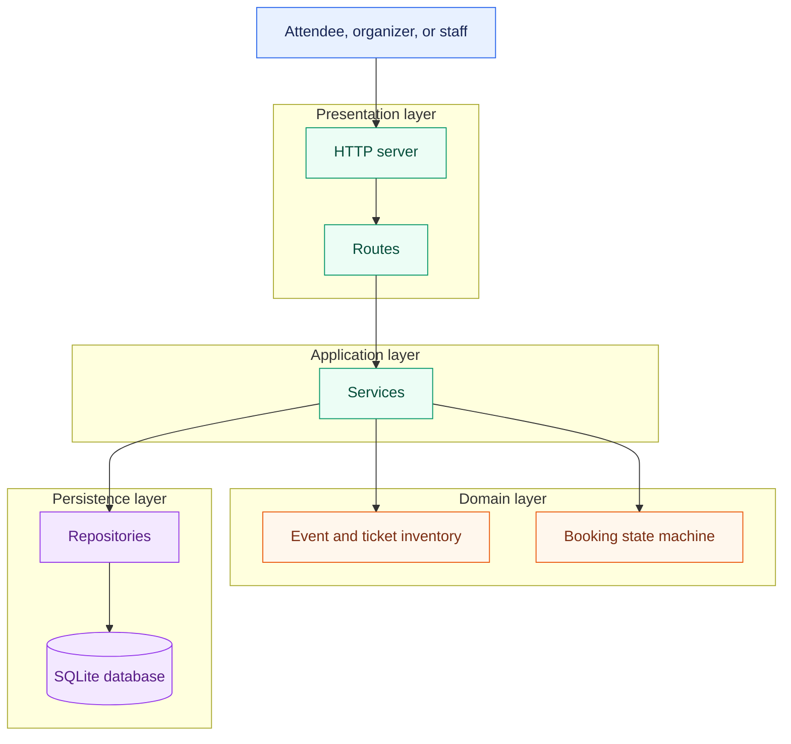
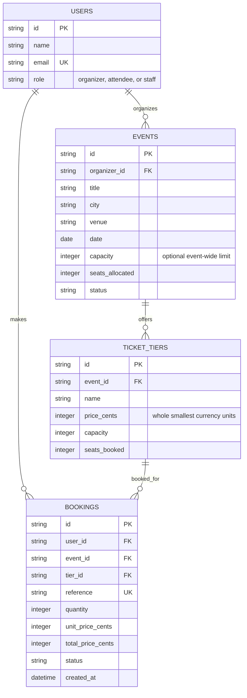
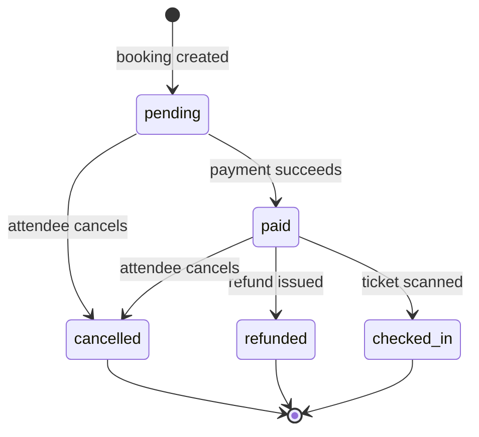

# Build 3 architecture

## Architecture flow

The diagram shows the target layered design. The current Build 3 server has HTTP routing and domain rules; services, repositories, and SQLite are introduced in later builds.

- **Routes** translate HTTP requests and responses; they do not contain business rules or access data directly.
- **Services** coordinate domain rules and repositories; they do not depend on HTTP details or call routes.
- **Domain rules** validate and apply business rules; they do not perform I/O or depend on services, repositories, or routes.
- **Repositories** read and write data; they do not make business decisions or call services, rules, or routes.
- **Database** stores persisted data; it does not call application layers.

## Data model

An event has ticket tiers; a booking reserves seats from one tier. Prices and totals are stored as whole smallest currency units, not decimals. `seats_booked` and `seats_allocated` track inventory usage; booking status follows the lifecycle below.

## Booking lifecycle

Only the transitions shown are valid. `cancelled`, `refunded`, and `checked_in` are terminal states.
